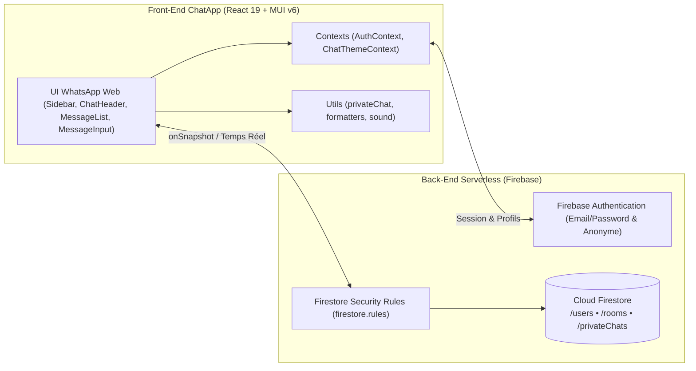

<div align="center">

# 💬 ChatApp — Messagerie Temps Réel Style WhatsApp (React & Firebase)

**Application web moderne de messagerie instantanée inspirée de WhatsApp Web, avec salons thématiques, discussions privées 1-à-1 sécurisées, notes vocales, partage de photos et personnalisation de thèmes.**

<p>
  
  
  
  
  
</p>

</div>

---

## 🧭 Architecture Globale



---

## ✨ Fonctionnalités Principales

### 💬 Messagerie & Ergonomie WhatsApp (`ChatPage`, `MessageList`, `MessageItem`)
- **Bulles de messages authentiques :** alignement envoi/réception, heure d'envoi, accusés de réception (`✓✓`) et séparateurs chronologiques automatiques (*Aujourd'hui*, *Hier*).
- **Interactions temps réel :** synchronisation instantanée via `onSnapshot`, son de notification synthétisé (Web Audio API) à la réception d'un message d'un autre utilisateur et bouton flottant de retour en bas.
- **Réactions & suppression sécurisée :** barre de réactions rapides par émoji (`👍 ❤️ 😂 😮 😢 🙏`) et suppression logique par l'auteur (`Ce message a été supprimé`), contrôlées par `firestore.rules`.
- **Recherche intégrée :** filtrage instantané des messages par texte ou auteur directement depuis `ChatHeader`.

### 🔒 Discussions Privées 1-à-1 (`NewPrivateChatModal`, `/dm/:chatId`)
- **Onglets séparés dans `Sidebar` :** bascule fluide entre les **Salons** publics et les discussions **Privés**.
- **Annuaire automatique (`/users`) :** liste filtrable de tous les utilisateurs inscrits ou connectés en mode invité pour démarrer un échange privé en un clic.
- **Identifiant déterministe (`uid1__uid2`) :** garantit une conversation unique par paire d'utilisateurs avec aperçu du dernier message et badge de message non lu.
- **Cloisonnement serveur :** seuls les deux participants autorisés peuvent lire, envoyer, réagir ou supprimer dans `/privateChats/{chatId}`.

### 📸 Partage de Photos & Notes Vocales (`MessageInput`, `ImagePreviewModal`, `VoiceNotePlayer`)
- **Envoi de photos optimisé :** compression automatique côté client via HTML5 Canvas (`1024px` max, JPEG 0.75), fenêtre d'aperçu avec légende avant envoi et visionneuse plein écran (Lightbox) avec téléchargement.
- **Notes vocales WhatsApp :** enregistrement audio en direct via `MediaRecorder` avec chronomètre, annulation, plafond de sécurité avant envoi et lecteur audio intégré avec vitesse de lecture (`1x`, `1.5x`, `2x`).
- **Sélecteur d'émojis :** intégré avec recherche via `emoji-picker-react`.

### 🎨 Thèmes Personnalisés & Authentification (`ChatThemeContext`, `AuthCard`, `EditProfileModal`)
- **7 thèmes au choix :** *WhatsApp Classique*, *WhatsApp Sombre*, *Bleu Océan*, *Lavande & Violet*, *Émeraude Menthe*, *Rose Pêche* et *Minuit Noir OLED*, avec option **Motif Doodle** sauvegardée par utilisateur.
- **Authentification flexible :** connexion/inscription par nom d'utilisateur, **Accès direct en tant qu'invité** (Firebase Anonymous Auth) et modification du pseudo/avatar en temps réel.
- **Salons thématiques :** 6 salons par défaut (*Général*, *Programmation*, *IA*, *Développement Web*, *Sécurité*, *Cloud Computing*) + création de salons personnalisés.

---

## 📁 Structure du Projet

```text
Chatbot/
├── public/                             # Icônes, manifest & index.html
├── src/
│   ├── config/
│   │   └── firebase.js                 # Initialisation Firebase (Auth, Firestore, Storage)
│   ├── contexts/
│   │   ├── AuthContext.js              # Session, login/register, mode invité & synchro /users
│   │   └── ChatThemeContext.js         # Thèmes WhatsApp, mode sombre/clair & préférence Doodle
│   ├── pages/
│   │   ├── AuthPage.js                 # Garde de route & redirection post-connexion
│   │   └── ChatPage.js                 # Cœur temps réel (salons publics /chat & privés /dm)
│   ├── components/
│   │   ├── Auth/
│   │   │   └── AuthCard.js             # Connexion, inscription, avatars & accès invité
│   │   ├── Chat/
│   │   │   ├── ChatHeader.js           # En-tête salon/contact, recherche & bouton thème
│   │   │   ├── EditProfileModal.js     # Édition du pseudo et de l'avatar utilisateur
│   │   │   ├── ImagePreviewModal.js    # Aperçu avant envoi & visionneuse plein écran
│   │   │   ├── MessageInput.js         # Saisie texte, émojis, photo compressée & micro vocal
│   │   │   ├── MessageItem.js          # Bulle de message, réactions & menu suppression
│   │   │   ├── MessageList.js          # Liste des messages groupés par date + scroll-to-bottom
│   │   │   ├── NewPrivateChatModal.js  # Modale de sélection d'utilisateur pour chat privé
│   │   │   ├── Sidebar.js              # Volet latéral (Salons, Privés, création & profil)
│   │   │   ├── ThemeSelectorModal.js   # Sélecteur visuel des 7 thèmes & Doodle
│   │   │   └── VoiceNotePlayer.js      # Lecteur audio des notes vocales (1x / 1.5x / 2x)
│   │   └── Common/
│   │       └── LoadingScreen.js        # Écran de chargement
│   ├── utils/
│   │   ├── formatters.js               # Formatage des heures et en-têtes de date
│   │   ├── privateChat.js              # Helpers ID déterministe & validation participants
│   │   └── sound.js                    # Son de notification Web Audio API
│   ├── App.js                          # Routing (/chat/:roomId, /dm/:chatId) & Providers
│   ├── App.test.js                     # Tests unitaires
│   └── index.js
├── firestore.rules                     # Règles de sécurité Firestore (salons, users, privateChats)
├── firebase.json                       # Configuration Firebase CLI
├── vercel.json                         # Configuration Vercel (SPA rewrites)
├── .env.example                        # Modèle des variables d'environnement Firebase
└── package.json
```

---

## 🛠️ Stack & Dépendances

| Couche | Technologies |
| :--- | :--- |
| **Front-End** | React `19.0`, Material-UI (`@mui/material`, `@mui/icons-material` `6.4`), Emotion, React Router `7.1` |
| **Composants & Médias** | `emoji-picker-react`, HTML5 Canvas, `MediaRecorder` API, Web Audio API |
| **Back-End & Base de données** | Firebase `11.2` (Authentication Email/Password + Anonyme, Cloud Firestore) |
| **Sécurité & Déploiement** | Firestore Security Rules (`firestore.rules`), Vercel (`vercel.json`) |

---

## 🚀 Installation & Lancement Local

### Prérequis
- [Node.js](https://nodejs.org/) **18+** installé
- Un projet [Firebase](https://console.firebase.google.com/) avec **Authentication** (Email/Mot de passe + Anonyme) et **Cloud Firestore** activés

### 1. Cloner et installer les dépendances
```bash
git clone https://github.com/hamzamachnaoui/Chatbot.git
cd Chatbot
npm install
```

### 2. Configurer l'environnement (`.env`)
Copiez `.env.example` vers `.env` et renseignez vos identifiants Firebase :
```env
REACT_APP_FIREBASE_API_KEY=votre_cle_api
REACT_APP_FIREBASE_AUTH_DOMAIN=votre_domaine.firebaseapp.com
REACT_APP_FIREBASE_PROJECT_ID=votre_projet_id
REACT_APP_FIREBASE_STORAGE_BUCKET=votre_bucket.firebasestorage.app
REACT_APP_FIREBASE_MESSAGING_SENDER_ID=votre_sender_id
REACT_APP_FIREBASE_APP_ID=votre_app_id
```

### 3. Déployer les règles Firestore
```bash
firebase deploy --only firestore:rules
```
*(Ou copiez le contenu de [`firestore.rules`](firestore.rules) dans **Firebase Console > Firestore Database > Règles**.)*

### 4. Lancer, tester et compiler
```bash
# Serveur de développement (http://localhost:3000)
npm start

# Tests unitaires
npm test

# Build de production
npm run build
```

---

## ☁️ Déploiement sur Vercel

Ce dépôt est directement prêt pour **Vercel** via [`vercel.json`](vercel.json) (réécriture des routes SPA `/chat/...` et `/dm/...`) :

1. Importez `hamzamachnaoui/Chatbot` dans **Vercel**.
2. Ajoutez les variables `REACT_APP_FIREBASE_*` dans **Project Settings → Environment Variables**.
3. Déployez : Vercel exécute `npm run build` et applique automatiquement le routage SPA.

---

## 👤 Auteur & Contact

Développé par **Mohamed Hamza Machnaoui**

<p>
  <a href="https://ma.linkedin.com/in/mohamed-hamza-machnaoui">
    
  </a>
  <a href="https://facebook.com/hamza.machnaoui">
    
  </a>
  <a href="https://github.com/hamzamachnaoui">
    
  </a>
</p>
